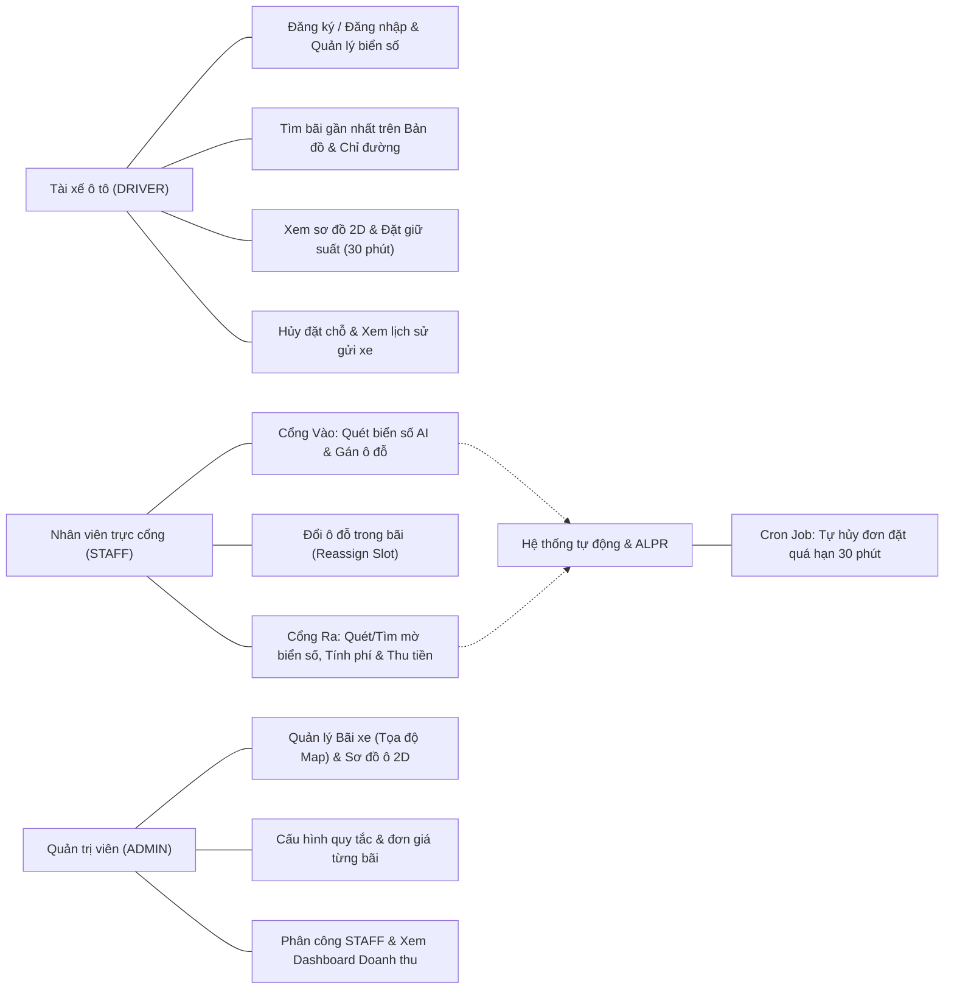
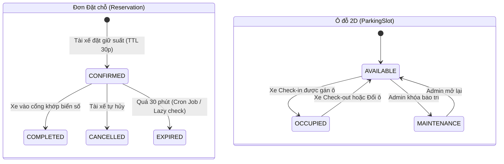
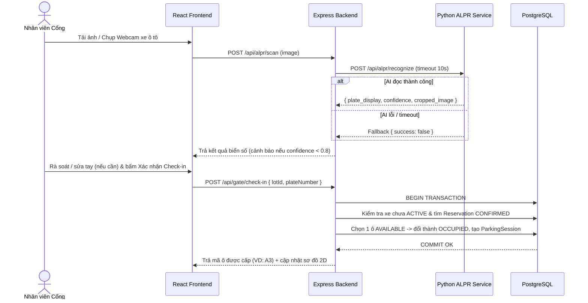
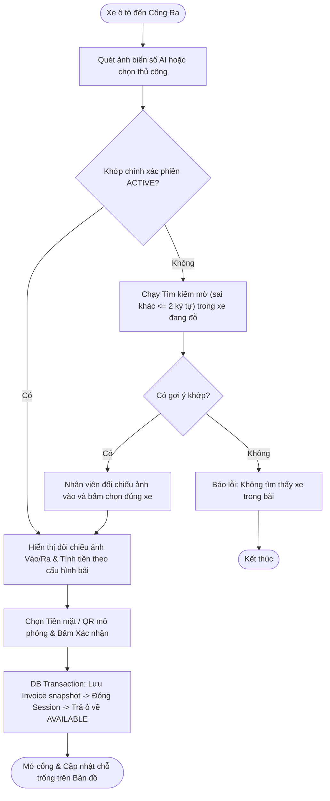
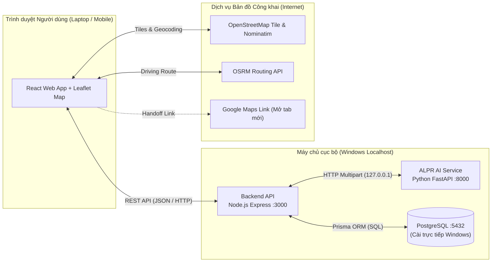

# SOFTWARE ARCHITECTURE DOCUMENT (SAD) — SMART PARKING SYSTEM

Tài liệu Kiến trúc & Thiết kế Phần mềm được xây dựng theo chuẩn quy trình **Thiết kế Kiến trúc Phần mềm** và mô hình **4+1 View (Philippe Kruchten)**, đảm bảo nguyên tắc *Minimize Large Design Upfront* và tối ưu chi phí tài liệu `(Cx - Cy) > Cdiff`.

---

## 1. TỔNG QUAN BÀI TOÁN, STAKEHOLDERS & PHẠM VI

### 1.1. Đặt vấn đề thực tế
Người lái ô tô tại đô thị (dữ liệu mẫu tại **TP. Vinh, Nghệ An**) thường gặp 4 vấn đề cốt lõi: không biết bãi nào còn chỗ trống và giá bao nhiêu trước khi đi; chạy đến tận cổng mới biết hết chỗ phải quay đầu gây ùn tắc; khó tìm đúng đường ô tô vào cổng bãi; và ùn tắc/thiếu minh bạch tại cổng ra vào khi ghi vé thủ công.

### 1.2. Các bên liên quan (Stakeholders)
Hệ thống định nghĩa **03 vai trò người dùng** rõ ràng:
1. **Tài xế ô tô (`DRIVER`):** Tìm bãi đỗ gần vị trí hiện tại hoặc địa điểm sắp đến trên bản đồ, xem số chỗ trống & bảng giá, đặt giữ suất trước 30 phút, xem chỉ đường và theo dõi lịch sử gửi xe.
2. **Nhân viên trực cổng (`STAFF`):** Gắn cố định với **01 bãi xe được phân công** (`assigned_lot_id`), chịu trách nhiệm vận hành Cổng Vào/Ra, rà soát kết quả nhận diện biển số AI, gán/đổi ô đỗ và xác nhận thanh toán tại bãi đó.
3. **Quản trị viên (`ADMIN`):** Quản lý toàn bộ danh sách bãi đỗ xe (tọa độ bản đồ), sơ đồ lưới ô 2D, cấu hình quy tắc giá linh hoạt cho từng bãi, phân công nhân viên và theo dõi thống kê doanh thu.

### 1.3. Phạm vi & Ranh giới hệ thống (Scope & Assumptions)
* **Trong phạm vi (In-Scope):**
  * Chỉ áp dụng cho **xe ô tô**; triển khai dạng **Web Responsive** chạy cục bộ trên Windows.
  * Bản đồ **Leaflet + OpenStreetMap + OSRM** (kèm nút mở nhanh **Google Maps** miễn phí) với 5 bãi xe tọa độ thật tại TP. Vinh.
  * **Đặt chỗ theo sức chứa (Capacity-based)** giữ suất 30 phút (tự hủy quá hạn TTL, giới hạn chống spam tối đa 3 lần hủy/quá hạn mỗi ngày). Khi xe tới cổng mới gán ô cụ thể trên sơ đồ 2D (hỗ trợ *Đổi ô* và *chuyển vãng lai* nếu đến trễ).
  * **Cấu hình giá linh hoạt theo từng bãi** do Quản lý thiết lập (`HOURLY` theo giờ hoặc `PER_TURN` theo lượt, số phút miễn phí đầu), lưu cứng snapshot vào hóa đơn.
  * Dịch vụ AI đọc biển số ô tô **ALPR** (`Python FastAPI + OpenCV + EasyOCR`) kèm sửa tay *Human-in-the-loop* và *Tìm kiếm mờ (Fuzzy Search)* ở Cổng Ra.
* **Ngoài phạm vi (Out-of-Scope):** Không phần cứng IoT thật, không MQTT/Node-RED, không Docker/WSL, không Mobile App native, không cổng thanh toán ngân hàng thật, không camera RTSP 24/7, không xe máy/xe tải.
* **Giả định (Assumptions):** Bãi xe có hướng dẫn để tài xế đỗ đúng ô được nhân viên gán (nếu đỗ nhầm xử lý bằng chức năng *Đổi ô*); máy chạy demo có Internet để tải bản đồ OpenStreetMap/OSRM.

---

## 2. THUỘC TÍNH CHẤT LƯỢNG & KỊCH BẢN CHẤT LƯỢNG (QUALITY SCENARIOS — 6 THÀNH PHẦN)

Theo mô hình đặc tả chất lượng 6 thành phần (`Source – Stimulus – Environment – Artifact – Response – Response Measure`), 5 kịch bản kiến trúc trọng yếu của hệ thống gồm:

| ID | Thuộc tính | Source (Nguồn) | Stimulus (Sự kiện) | Environment (Môi trường) | Artifact (Thành phần) | Response (Phản ứng hệ thống) | Response Measure (Đo lường) |
| :--- | :--- | :--- | :--- | :--- | :--- | :--- | :--- |
| **QA-01** | **Reliability / Concurrency** | 2 Tài xế | Cùng bấm đặt suất trống cuối cùng của bãi tại cùng 1 thời điểm | Bình thường | Backend API & PostgreSQL | Khóa giao dịch (Transaction) kiểm tra sức chứa khả dụng (`usableSlots - activeSessions - confirmedReservations > 0`); chỉ cho 1 đơn thành công, đơn sau nhận `409 Conflict` | 0% trường hợp đặt vượt sức chứa bãi (overbooking) |
| **QA-02** | **Availability / Fault Tolerance** | Dịch vụ AI `alpr-service` | Quá tải, tắt đột ngột hoặc ảnh mờ không đọc được biển số | Đang trực cổng vào/ra | Backend Gate Service & UI Staff | Timeout tối đa 10 giây; hiển thị cảnh báo độ tin cậy thấp và mở ô nhập/sửa tay biển số (*Human-in-the-loop*) | 100% luồng Check-in/Check-out vẫn hoạt động bình thường kể cả khi `alpr-service` tắt |
| **QA-03** | **Usability / Robustness** | Tài xế ô tô | Trình duyệt chặn GPS hoặc OSRM API chỉ đường bị chậm | Đang tìm bãi trên Laptop/Mobile | Frontend Map Module | Cho phép chấm tay vị trí hoặc tìm theo địa chỉ; nếu OSRM > 5s thì vẽ đường nối dự phòng + luôn có nút "Mở bằng Google Maps" | Tài xế vẫn tìm được bãi và xem chỉ đường trong ≤ 3 thao tác |
| **QA-04** | **Security (RBAC)** | Nhân viên `STAFF` Bãi A | Cố tình gọi API Check-in/sửa dữ liệu của Bãi B hoặc API Admin | Đã đăng nhập JWT | Auth & Scope Middleware | Kiểm tra `role` và đối chiếu `user.assigned_lot_id === targetLotId`; từ chối ngay với `403 Forbidden` | 100% request vượt phạm vi bãi bị chặn |
| **QA-05** | **Modifiability** | Quản trị `ADMIN` | Thay đổi quy tắc/đơn giá của 1 bãi xe (VD: tăng giá giờ từ 20k lên 30k) | Đang vận hành | Billing Engine & bảng `invoices` | Áp dụng giá mới cho lượt xe sau; hóa đơn cũ vẫn giữ nguyên nhờ `pricing_snapshot` đã lưu cứng | 0 hóa đơn lịch sử bị sai lệch số tiền sau khi đổi giá |

---

## 3. PHONG CÁCH KIẾN TRÚC & MÔ HÌNH 4+1 VIEW

Hệ thống áp dụng phong cách **Client/Server kết hợp Layered Architecture** cho Backend (`Routes/Controllers → Services → Prisma Data Access`) và tách biệt **01 dịch vụ AI độc lập (`alpr-service`)** giao tiếp qua HTTP nội bộ để đảm bảo nguyên tắc *Separation of Concerns*, *Single Responsibility* và *Decoupling*.

---

### 3.1. (+1) Scenario View — Biểu đồ Use Case Tổng quan



---

### 3.2. Logical View — Thiết kế Dữ liệu (ERD 7 bảng) & Trạng thái

#### A. Sơ đồ quan hệ Cơ sở dữ liệu (PostgreSQL + Prisma — 7 bảng)

```mermaid
erDiagram
    USERS ||--o{ VEHICLES : owns
    USERS ||--o{ RESERVATIONS : creates
    PARKING_LOTS ||--o{ USERS : assigns_staff
    PARKING_LOTS ||--o{ PARKING_SLOTS : contains
    PARKING_LOTS ||--o{ RESERVATIONS : receives
    PARKING_LOTS ||--o{ PARKING_SESSIONS : hosts
    PARKING_SLOTS ||--o{ PARKING_SESSIONS : occupies
    RESERVATIONS ||--o| PARKING_SESSIONS : fulfills
    PARKING_SESSIONS ||--o| INVOICES : bills

    USERS {
        uuid id PK
        string full_name
        string email UK
        string password_hash
        string role "DRIVER | STAFF | ADMIN"
        uuid assigned_lot_id FK "Nullable, chỉ dùng cho STAFF"
        timestamp created_at
    }

    VEHICLES {
        uuid id PK
        uuid user_id FK
        string plate_normalized "VD: 37A12345"
        string plate_display "VD: 37A-123.45"
        string car_brand
    }

    PARKING_LOTS {
        uuid id PK
        string name
        string address
        float latitude
        float longitude
        string pricing_type "HOURLY | PER_TURN"
        int free_minutes "VD: 15"
        decimal base_price "VNĐ/giờ hoặc VNĐ/lượt"
        string open_time
        string close_time
        boolean is_active
    }

    PARKING_SLOTS {
        uuid id PK
        uuid lot_id FK
        string code "VD: A1, B2"
        string zone "VD: A, B"
        int row_index
        int col_index
        string status "AVAILABLE | OCCUPIED | MAINTENANCE"
    }

    RESERVATIONS {
        uuid id PK
        uuid user_id FK
        uuid lot_id FK
        string plate_normalized
        string status "CONFIRMED | COMPLETED | CANCELLED | EXPIRED"
        timestamp created_at
        timestamp expires_at "created_at + 30 phút"
    }

    PARKING_SESSIONS {
        uuid id PK
        uuid lot_id FK
        uuid slot_id FK
        uuid reservation_id FK "Nullable"
        string plate_normalized
        timestamp check_in_time
        timestamp check_out_time "Nullable"
        string check_in_image
        string check_out_image
        string status "ACTIVE | COMPLETED"
    }

    INVOICES {
        uuid id PK
        uuid session_id FK_UK
        int total_minutes
        json pricing_snapshot "Lưu cứng loại giá, đơn giá, free_minutes"
        decimal total_amount
        string payment_method "CASH | QR_SIMULATED"
        string status "PAID"
        timestamp paid_at
    }
```

> **Lưu ý thiết kế:** Vì hệ thống áp dụng **Đặt theo sức chứa (Capacity-based)**, bảng `PARKING_SLOTS` chỉ có 3 trạng thái thực tế (`AVAILABLE`, `OCCUPIED`, `MAINTENANCE`). Số suất trống khả dụng của một bãi được tính chính xác tại mọi thời điểm bằng công thức:
> $$\text{availableCapacity} = \text{COUNT(slots WHERE status = 'AVAILABLE')} - \text{COUNT(reservations WHERE status = 'CONFIRMED' AND expires\_at > NOW())}$$

#### B. Biểu đồ Máy trạng thái (State Machine Diagrams)



#### C. Biểu đồ Tuần tự (Sequence Diagram — Luồng Xe vào cổng tích hợp ALPR)



---

### 3.3. Process View — Luồng xử lý nghiệp vụ & Đồng thời (Activity Diagram)



---

### 3.4. Development View — Cấu trúc Mã nguồn (Component / Package Diagram)

```text
smart-parking-system/
├── backend/                  # Node.js + Express + TypeScript + Prisma
│   ├── prisma/
│   │   ├── schema.prisma     # Định nghĩa 7 bảng PostgreSQL
│   │   └── seed.ts           # Dữ liệu 5 bãi xe TP. Vinh + tài khoản mẫu
│   └── src/
│       ├── middlewares/      # auth.middleware.ts (JWT + RBAC theo assigned_lot_id)
│       ├── modules/          # Tách rõ theo từng nghiệp vụ (SRP)
│       │   ├── auth/
│       │   ├── vehicles/
│       │   ├── lots/         # Tìm bãi Haversine, CRUD bãi/ô, cấu hình giá
│       │   ├── reservations/ # Đặt theo sức chứa, chống spam, Cron TTL 30p
│       │   ├── gate/         # Check-in, Đổi ô, Check-out + Fuzzy Search + Billing
│       │   └── analytics/    # Dashboard KPI & lịch sử
│       └── utils/            # Chuẩn hóa biển số VN, Haversine, gọi ALPR
├── frontend/                 # React + TypeScript + Tailwind CSS + Leaflet
│   └── src/
│       ├── pages/
│       │   ├── driver/       # Bản đồ TP. Vinh, Chỉ đường, Đặt chỗ, Lịch sử
│       │   ├── staff/        # Cổng Vào/Ra, Webcam/Upload AI, Sơ đồ 2D, Đổi ô
│       │   └── admin/        # Quản lý Bãi (chấm Map), Giá, Nhân viên, Dashboard
│       └── components/
├── alpr-service/             # Python 3.10 + FastAPI + OpenCV + EasyOCR
│   ├── main.py               # API POST /api/alpr/recognize
│   ├── detector.py           # Tiền xử lý, cắt biển số & đọc 1 dòng / 2 dòng
│   ├── postprocess.py        # Sửa lỗi ký tự OCR + Regex biển số ô tô VN
│   └── sample_plates/        # Bộ 15-20 ảnh ô tô VN mẫu để kiểm thử demo
├── docs/
│   └── SAD.md                # Tài liệu Kiến trúc phần mềm duy nhất (4+1 View)
├── MoTaCongViec.md           # Lộ trình 9 Sprint & mẫu nhật ký Issues
└── README.md
```

---

### 3.5. Physical View — Sơ đồ Triển khai (Deployment Diagram)


